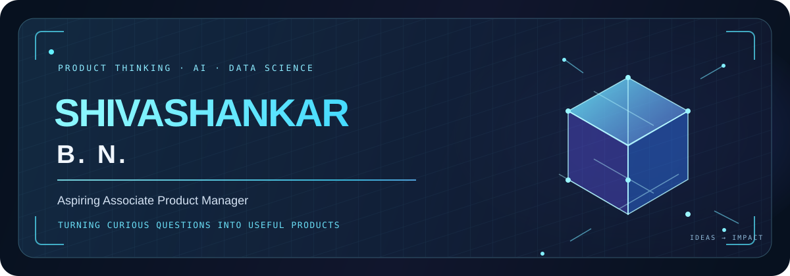

 

---

## 👋 About Me

I enjoy using data and technology to understand problems and build practical solutions. My work spans data analysis, machine learning, business intelligence, and web applications—from exploring patterns in real-world datasets to creating dashboards and intelligent civic tools.

- 📊 Data science, analytics, and data storytelling
- 🤖 Machine learning and predictive modeling
- 🛠️ Python, dashboards, and data-driven applications
- 🌱 Learning through hands-on projects and collaboration

---

## 🚀 Featured Projects

<table>
  <tr>
    <td width="50%" valign="top">
      <h3>🍽️ Bengaluru Food Chain Sales Intelligence</h3>
      
Full-stack sales intelligence and analytics dashboard for Bengaluru food-chain data.

      
<strong>Stack:</strong> React · FastAPI · Python

      <a href="https://github.com/shivashankar-b-n/bengaluru-food-chain-sales-intelligence">Explore project →</a>
    </td>
    <td width="50%" valign="top">
      <h3>🏙️ Smart City by CIVIC</h3>
      
AI-powered civic intelligence for reporting, routing, tracking, and analyzing urban issues, with GIS and city-level insights.

      <a href="https://github.com/shivashankar-b-n/Smart-City-by-Civic">Explore project →</a>
    </td>
  </tr>
  <tr>
    <td width="50%" valign="top">
      <h3>🗺️ Crime Pattern Analysis & Prediction</h3>
      
Explores crime patterns across location, time, and categories with statistical analysis and classification models.

      <a href="https://github.com/shivashankar-b-n/Crime-Pattern-Analysis-and-Prediction-Based-on-Location-Time-and-Crime-Type">Explore project →</a>
    </td>
    <td width="50%" valign="top">
      <h3>🚢 Titanic Survival Prediction</h3>
      
A machine-learning project exploring passenger data and predicting survival outcomes.

      <a href="https://github.com/shivashankar-b-n/Titanic-Survival-Prediction">Explore project →</a>
    </td>
  </tr>
</table>

---

## 🧰 Tech Stack

**Focus areas:** exploratory data analysis · machine learning · dashboards · data visualization · API-powered applications

---

## 📊 GitHub Dashboard

  
  

  

  

---

### Thanks for visiting my profile 👋

Turning curiosity into insights, and insights into impact.

